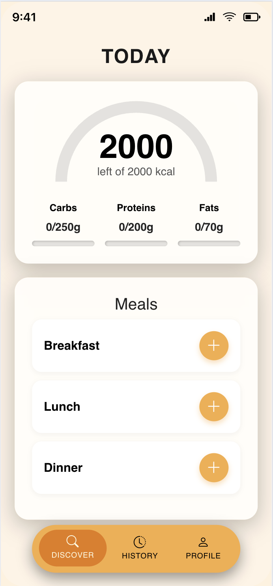
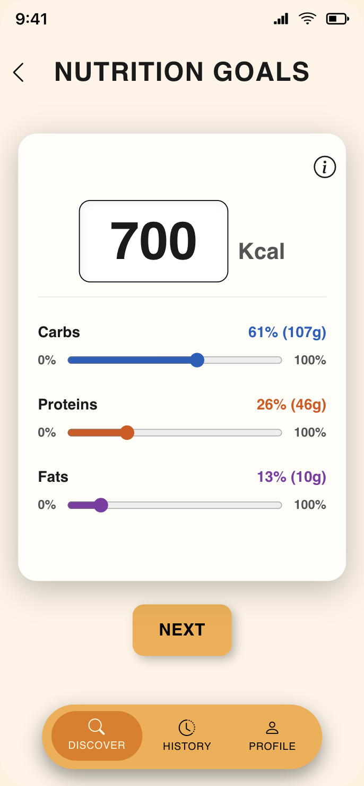
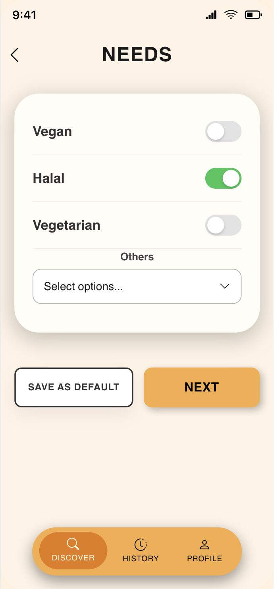
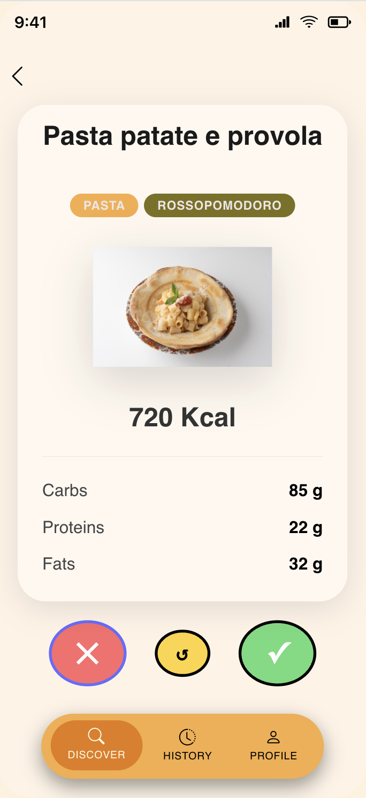
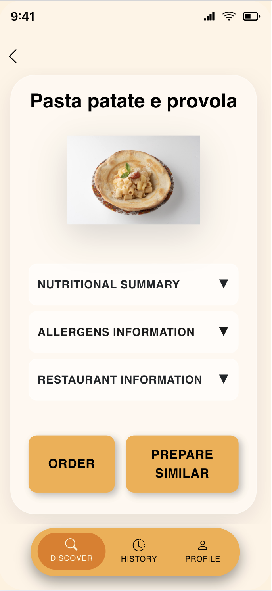
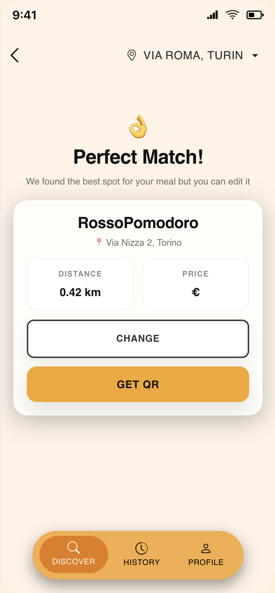
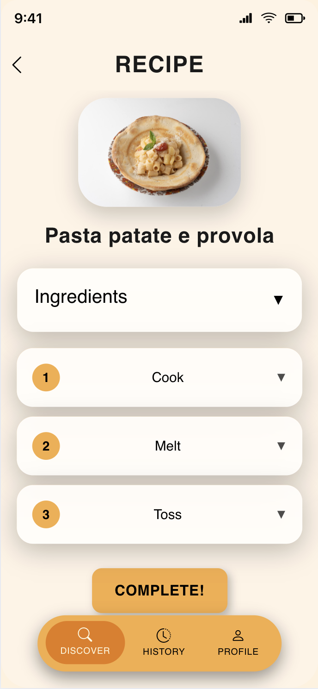
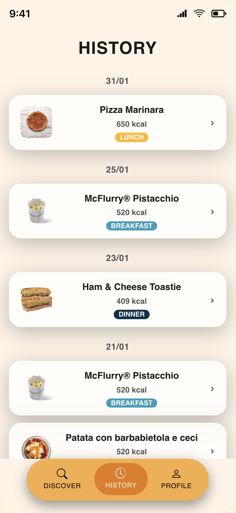
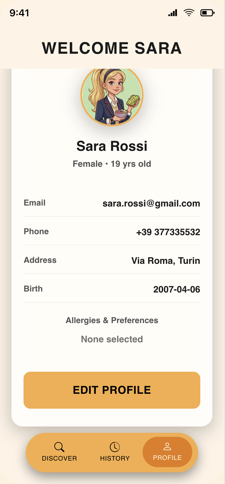

##  Project Overview

Nutrigenie is a full-stack web application that helps users track and manage their nutritional habits.  

Beyond simple tracking, the application allows users to search for meals that match specific macronutrients and calorie targets. Once a suitable dish is identified, the user can either prepare it at home using a provided recipe or order it at a nearby restaurant. In the latter case, a QR code is generated, which can be shown to the restaurant staff to simplify the ordering process.

It combines a React frontend with a Node.js + Express backend and uses SQLite as a lightweight database.

## ⚠️ FINAL REPORT 
A detailed description of the system workflow is provided in the final report

📄 Final Report: [View PDF](media/Nutrigenie-Report.pdf)

## Requirements
- Node.js (v18+ recommended)
- npm

## Installation

```bash
git clone https://github.com/RizzoGabriele/nutrigenie-fullstack
```
```bash
cd nutrigenie-fullstack
```
```bash
npm install
```

## How to run
### 1. Start the frontend (Vite)
```bash
npm run dev
```
### 2. Start the Backend (Express)
```bash
npm run server
```

## Notes
- Frontend runs with Vite (React)
- Backend runs with Express (server.js)
- Database is SQLite (local file-based, no setup required)
- Make sure both frontend and backend are running simultaneously
- Project developed for educational purposes

## Architecture
- **Frontend**: React (Vite) + React Router + Bootstrap
- **Backend**: Node.js + Express
- **Database**: SQLite (local file-based DB)
- **Communication**: RESTful API (HTTP between client and server)

## Technologies Used
- **React**: UI component-based library for building the frontend
- **React Router DOM**: client-side routing for navigation
- **Node.js**: Express – backend runtime and REST API handling
- **SQLite**: lightweight relational database stored in a single file
- **Bootstrap**: styling and responsive UI components
- **react-qr-code**: QR code generation in the frontend
- **Vite**: frontend build tool and development server

## Features
- Dynamic frontend interface
- REST API communication between client and server
- Persistent local data storage with SQLite
- QR code generation for sharing data

## Dynamic Routes
- `/meal/:id`  
  Displays meals based on the selected macro or category.

- `/meal/:id/mealInfo`  
  Shows detailed information for a specific meal.

- `/meal/:id/recipe`  
  Provides the recipe view for the selected meal.

- `/:mealId/:typeMealId/confirm`  
  Final confirmation step, where both meal type and meal ID define the context.

## Screenshot
<p align="center">
    
    &nbsp;
    
    &nbsp;
    
    &nbsp;
    
    &nbsp;
    
</p>
<p align="center">
    
    &nbsp;
    
    &nbsp;
    
    &nbsp;
    
    &nbsp;
    
</p>

## Project Structure

- /src
    - App.css
    - App.jsx
    - /components
        - BackButton.css
        - BackButton.jsx
        - ChooseButtons.css
        - ChooseButtons.jsx
        - CustomSelect.jsx
        - IOSStatusBar.css
        - IOSStatusBar.jsx
        - MealPropose.css
        - MealPropose.jsx
        - Menu.css
        - Menu.jsx
        - Popup.css
        - Popup.jsx
        - RestaurantInfo.jsx
        - UserAddress.css
        - UserAddress.jsx
    - index.css
    - main.jsx
    - /pages
        - ChooseCalories.css
        - ChooseCalories.jsx
        - ChooseMeal.jsx
        - Confirm.css
        - Confirm.jsx
        - EditProfile.css
        - EditProfile.jsx
        - History.css
        - History.jsx
        - Home.css
        - Home.jsx
        - Layout.jsx
        - MacrosContext.jsx
        - MealInfo.css
        - MealInfo.jsx
        - MealReady.css
        - MealReady.jsx
        - Profile.css
        - Profile.jsx
        - QrCode.css
        - QrCode.jsx
        - Recipe.css
        - Recipe.jsx
        - Sel_Restaur.css
        - Sel_Restaur.jsx
        - SetNeeds.css
        - SetNeeds.jsx
        - ViewMeal.css
        - ViewMeal.jsx

## Database Schema

### history_day

| Column     | Type    | Constraints                                  |
| ---------- | ------- | -------------------------------------------- |
|id|	INTEGER|	PRIMARY KEY AUTOINCREMENT|
|day_date|	TEXT|	NOT NULL, UNIQUE (YYYY-MM-DD)|

### history_item

| Column     | Type    | Constraints                                  |
| ---------- | ------- | -------------------------------------------- |
|id	|INTEGER	 | PRIMARY KEY AUTOINCREMENT|
|day_id      | INTEGER |	NOT NULL, FOREIGN KEY → history_day(id) ON DELETE CASCADE|
|dish_name_en| TEXT	   |NOT NULL|
|image_url	 | TEXT	   |-|
|kcal        | INTEGER |NOT NULL|
|carbs_g     | REAL	|NOT NULL|
|protein_g   | REAL	|NOT NULL|
|fat_g	     | REAL     |    NOT NULL|
|created_at	 |TEXT      |	NOT NULL, DEFAULT datetime('now')|
|typeMeal	 |INTEGER   |	NOT NULL, DEFAULT 1|


### all_prefs

| Column     | Type    | Constraints                                  |
| ---------- | ------- | -------------------------------------------- |
|id	|INTEGER	|PRIMARY KEY AUTOINCREMENT|
|name	|TEXT|	NOT NULL|

### user_allergens

| Column     | Type    | Constraints                                  |
| ---------- | ------- | -------------------------------------------- |
|id	|INTEGER|	PRIMARY KEY AUTOINCREMENT|
|email	|TEXT	|FOREIGN KEY → users(email)|
|id_all|	INTEGER	|FOREIGN KEY → all_prefs(id) (assumed, original missing reference)|

### users

| Column     | Type    | Constraints                                  |
| ---------- | ------- | -------------------------------------------- |
|name	|TEXT|	NOT NULL|
|surname	|TEXT	|NOT NULL|
|email	|TEXT|	PRIMARY KEY|
|birth	|TEXT|	NOT NULL|
|phone	|TEXT|	NOT NULL|
|gender	|TEXT|	NOT NULL|
|profilePic|	TEXT	|-|
|address|	TEXT|	-|

### Recipes
| Column     | Type    | Constraints                                  |
| ---------- | ------- | -------------------------------------------- |
|id|	INTEGER	|PRIMARY KEY AUTOINCREMENT|
|meal_id	|INTEGER|	FOREIGN KEY → Meals(id)|
|step_number|	INTEGER	|-|
|step_title|	TEXT|	-|
|step_details|	TEXT|	-|

### Ingredients
| Column     | Type    | Constraints                                  |
| ---------- | ------- | -------------------------------------------- |
|id	|INTEGER	|PRIMARY KEY AUTOINCREMENT|
|meal_id	|INTEGER	|FOREIGN KEY → Meals(id)|
|name	|TEXT	|-|
|grams	|TEXT	|-|

### user_needs

| Column     | Type    | Constraints                                  |
| ---------- | ------- | -------------------------------------------- |
|email	|TEXT	|PRIMARY KEY, FOREIGN KEY → users(email) ON DELETE CASCADE|
|total_calories|	INTEGER	|NOT NULL, CHECK > 0|
|total_protein	|INTEGER	|NOT NULL|
|total_carbs	|INTEGER	|NOT NULL|
|total_fats	|INTEGER	|NOT NULL|
|created_at	|DATETIME	|DEFAULT CURRENT_TIMESTAMP|
|updated_at	|DATETIME	|DEFAULT CURRENT_TIMESTAMP|

### user_intake

| Column     | Type    | Constraints                                  |
| ---------- | ------- | -------------------------------------------- |
|email	|TEXT|	NOT NULL, FOREIGN KEY → users(email) ON DELETE CASCADE|
|day	|DATE|	NOT NULL|
|eaten_calories	|INTEGER|	NOT NULL, DEFAULT 0|
|eaten_protein	|INTEGER|	NOT NULL, DEFAULT 0|
|eaten_carbs	|INTEGER|	NOT NULL, DEFAULT 0|
|eaten_fats	|INTEGER|	NOT NULL, DEFAULT 0|
|PRIMARY KEY |(email, day) |composite key|

### Meals_Allergens

| Column     | Type    | Constraints                                  |
| ---------- | ------- | -------------------------------------------- |
|id	|INTEGER	|PRIMARY KEY AUTOINCREMENT|
|meal_id|	INTEGER|	FOREIGN KEY → Meals(id) ON DELETE CASCADE|
|pref_id|	INTEGER	|FOREIGN KEY → all_prefs(id) ON DELETE CASCADE|

### restaurant

| Column     | Type    | Constraints                                  |
| ---------- | ------- | -------------------------------------------- |
|id	|INTEGER|	PRIMARY KEY AUTOINCREMENT|
|name	|TEXT|	NOT NULL|
|address|	TEXT|	NOT NULL|
|city	|TEXT	|NOT NULL|
|latitude|	REAL	|NOT NULL|
|longitude|	REAL|	NOT NULL|
|price_range|	INTEGER|	-|

### Meals

| Column     | Type    | Constraints                                  |
| ---------- | ------- | -------------------------------------------- |
|id	|INTEGER|	PRIMARY KEY|
|name	|TEXT|	NOT NULL|
|category	|TEXT	|NOT NULL|
|ristorante|	TEXT|	NOT NULL|
|foto	|TEXT|	NOT NULL|
|calorie	|REAL|	NOT NULL|
|carbo	|INTEGER|	NOT NULL|
|proteins	|INTEGER|	NOT NULL|
|fat|	INTEGER|	NOT NULL|
|meal_time|	TEXT	|NOT NULL, DEFAULT 'main'|

### meal_completion
| Column     | Type    | Constraints                                  |
| ---------- | ------- | -------------------------------------------- |
|meal_id	|INTEGER|	NOT NULL|
|day	|TEXT|	NOT NULL|
|completed	|INTEGER|	NOT NULL, DEFAULT 0|
|PRIMARY KEY	|(meal_id, day)	|composite key|

## API Overview

### User
- GET `/api/user/:email`
    - Get user profile
    ```
    {
        "name": "Sara",
        "surname": "Rossi",
        "email": "sara.rossi@gmail.com",
        "birth": "2007-04-06",
        "phone": "+39 377335532",
        "gender": "Female",
        "profilePic": "img/sara.jpg",
        "address": "Via Roma, Turin"
    }
    ```
- POST `/api/user/update`
    - Update user profile + allergens
    ```
    {
        "name": "Sara",
        "surname": "Rossi",
        "email": "sara.rossi@gmail.com",
        "birth": "2000-01-01",
        "phone": "123456789",
        "gender": "F",
        "profilePic": "",
        "address": "Torino"
    }
    ```
- POST `/api/user/allergens/update`
    - Update user allergens only
    ```
    {
        "message": "Allergens updated successfully"
    }
    ```

### Allergies / Preferences
- GET `/api/preferences`
    - Get all available preferences/allergens
    ```
    {
        "id": 1,
        "name": "Gluten free"
    },
    {
        "id": 2,
        "name": "Lactose free"
    },
    {
        "id": 3,
        "name": "Dairy free"
    },
    {
        "id": 4,
        "name": "Histamine intolerance"
    },
    {
        "id": 5,
        "name": "Nickel intolerance"
    }
    .....
    ```
- GET `/api/user/:email/allergies`
    - Get user allergen IDs
    ```
    {
        1,
        2,
        3
    }
    ```
- GET `/api/user/:email/allergies/names`
    - Get user allergen names
    ```
    {
        "Gluten free",
        "Lactose free",
        "Dairy free"
    }
    ```
- GET `/api/meals/:id/allergens/names`
    - Get allergens for a meal
    ```
    {
        "id": 1,
        "name": "Gluten free"
    },
    {
        "id": 11,
        "name": "Milk free"
    },
    {
        "id": 11,
        "name": "Milk free"
    },
    {
        "id": 17,
        "name": "Vegetarian"
    }
    ```

### Meals
- GET `/api/meals`
    - Get all meals
    ```
    {
        "id": 205,
        "name": "Carbonara",
        "category": "Pasta",
        "ristorante": "RossoPomodoro",
        "foto": "https://storage.googleapis.com/qoup-prod-app-image-api-kx8-prod-menu-images/DATI/products/resized/2955/1729244220.jpg",
        "calorie": 850,
        "carbo": 80,
        "proteins": 30,
        "fat": 45,
        "meal_time": "main",
        "pref_ids": [
        5,
        7,
        11,
        11,
        20,
        23,
        24,
        25,
        25
        ]
    },
    ...
    ```
- GET `/api/meals/:id`
    - Get single meal
    ```
    {
        "id": 245,
        "name": "Classic Hot Chocolate",
        "category": "Beverage",
        "ristorante": "Starbucks",
        "foto": "/img/245.png",
        "calorie": 372,
        "carbo": 43,
        "proteins": 14,
        "fat": 16,
        "meal_time": "breakfast"
        }
    ```
- GET `/api/meal/:id/recipe`
    - Get meal + ingredients + steps
    ```
    {
    "info": {
        "id": 245,
        "name": "Classic Hot Chocolate",
        "category": "Beverage",
        "ristorante": "Starbucks",
        "foto": "/img/245.png",
        "calorie": 372,
        "carbo": 43,
        "proteins": 14,
        "fat": 16,
        "meal_time": "breakfast"
    },
    "ingredients": [
        {
        "name": "Milk",
        "grams": "350ml"
        },
        {
        "name": "Chocolate powder",
        "grams": "35g"
        }
    ],
    "steps": [
        {
        "step_number": 1,
        "step_title": "Preparation",
        "step_details": "Steam the milk."
        },
        {
        "step_number": 2,
        "step_title": "Mixing",
        "step_details": "Add the chocolate powder and mix well."
        }
    ]
    }
    ```

### Nutrition tracking
- GET `/api/getCalories`
    - Get daily nutrition progress (calories/macros left)
    ```
    {
        "caloriesLeft": 2000,
        "totalCalories": 2000,
        "proteinLeft": 200,
        "proteinTotal": 200,
        "carbsLeft": 250,
        "carbsTotal": 250,
        "fatsLeft": 70,
        "fatsTotal": 70
    }
    ```
- POST `/api/meal/:mealId/complete`
    - Mark meal as completed + update history + intake
    ```
    {
        "message": "Meal completed and logged successfully!"
    }
    ```
- GET `/api/meal/:mealId/completed`
    - Check if meal is completed today
    ```
    {
        "completed": true
    }
    ```

### History
- GET `/api/history`
    - Get food history grouped by day
    ```
    [
        {
            "date": "2026-04-17",
            "items": [
            {
                "id": 67,
                "dish_name_en": "Classic Hot Chocolate",
                "image_url": "/img/245.png",
                "kcal": 372,
                "carbs_g": 43,
                "protein_g": 14,
                "fat_g": 16,
                "created_at": "2026-04-17 11:28:22",
                "typeMeal": "Lunch"
            },
            {
                "id": 66,
                "dish_name_en": "Classic Hot Chocolate",
                "image_url": "/img/245.png",
                "kcal": 372,
                "carbs_g": 43,
                "protein_g": 14,
                "fat_g": 16,
                "created_at": "2026-04-17 11:28:14",
                "typeMeal": "Lunch"
            }
            ]
        },
        ...
    ]
    ```

### Restaurant
- GET `/api/restaurant/:restaurantName`
    - Get restaurant details
    ```
    [
        {
            "id": 1,
            "name": "McDonald",
            "address": "Corso Francia 262",
            "city": "Torino",
            "latitude": 45.073919142352864,
            "longitude": 7.567162028910142,
            "price_range": 1
        },
        {
            "id": 2,
            "name": "McDonald",
            "address": "Via Nizza 230",
            "city": "Torino",
            "latitude": 45.032069997183186,
            "longitude": 7.664913625123903,
            "price_range": 1
        },
        ...
    ]
    ```